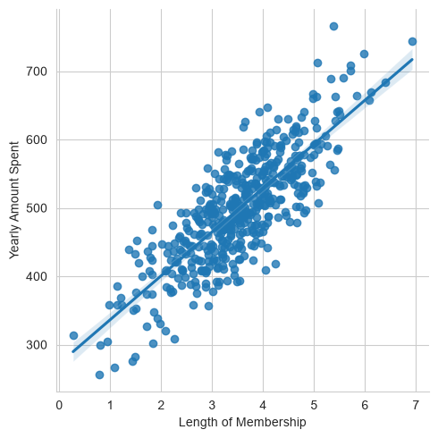
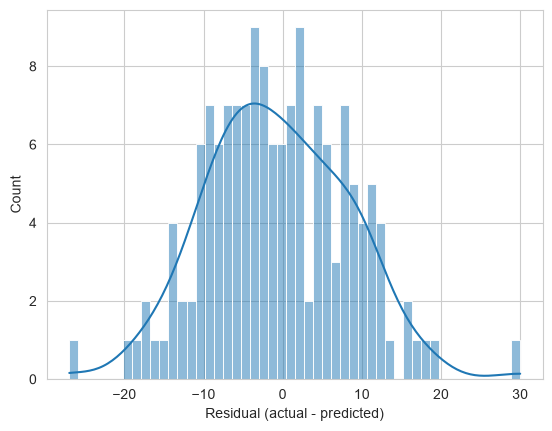

# 01 · Linear Regression: What Drives Yearly Customer Spend?

**Question:** An online retailer sells through a mobile app and a website. Should it invest more in the app or in the website?

**Data:** 500 customers: average session length, time on app, time on website, length of membership, yearly amount spent (synthetic).

**Approach:** EDA with seaborn → multiple linear regression (70/30 split) → evaluation with MAE, RMSE, R² and residual analysis → coefficient interpretation.

## Results

| Metric | Value |
|---|---|
| MAE | 7.23 |
| RMSE | 8.93 |
| R² | 0.989 |

| Feature | Coefficient (effect on yearly spend for +1 unit) |
|---|---|
| Length of Membership | **+$61.28** |
| Time on App | **+$38.59** |
| Avg. Session Length | +$25.98 |
| Time on Website | +$0.19 |

 

## Takeaways
- **Length of membership** is the strongest driver of spend, so customer retention matters most.
- The **app** is far more productive than the **website** per unit of time.
- The company can either double down on the app or fix the website. The right choice depends on cost, which the data does not cover.

➡️ [Open the notebook](notebook.ipynb)
