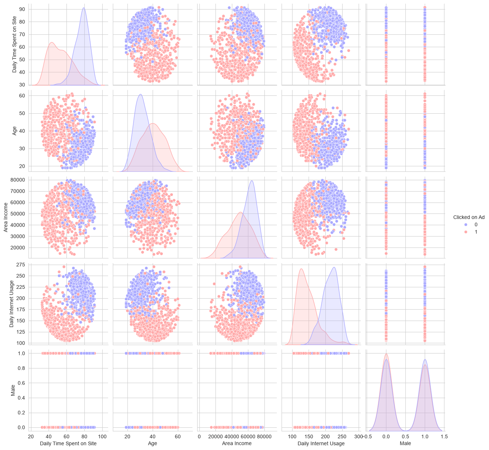

# 02 · Logistic Regression: Predicting Ad Clicks

**Question:** Can we predict whether a user clicks on an online ad from their age, income and browsing behaviour?

**Data:** 1,000 users: daily time on site, age, area income, daily internet usage, gender, and whether they clicked (synthetic).

**Approach:** EDA (pairplot by click status) → logistic regression on five numeric features → confusion matrix and classification report.

## Results

| | Precision | Recall | F1 |
|---|---|---|---|
| Did not click | 0.96 | 0.98 | 0.97 |
| Clicked | 0.98 | 0.96 | 0.97 |
| **Accuracy** | | | **0.97** |

Only 11 of 330 test users were misclassified.

## Takeaways
- Users who click spend **less time on the site** and **less time online** overall, and tend to be older.
- These two usage features separate the classes so well that a simple linear decision boundary is enough.

**Next steps:** feature scaling, coefficient / odds-ratio interpretation, ROC-AUC.

➡️ [Open the notebook](notebook.ipynb)
