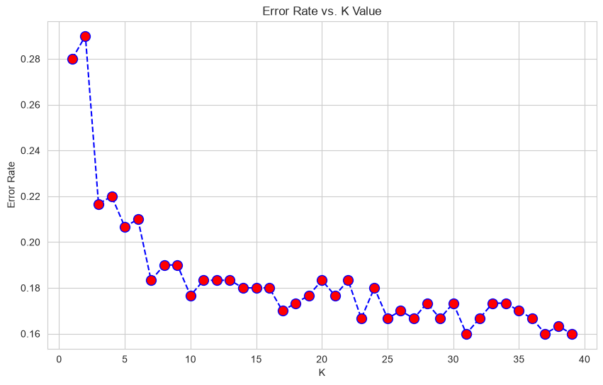

# 03 · K-Nearest Neighbors: Choosing K with the Elbow Method

**Question:** How much does the choice of K matter for a KNN classifier, and how do we pick it?

**Data:** 1,000 observations, 10 anonymised numeric features, binary target (synthetic).

**Approach:** Standardise features (KNN is distance-based) → baseline K = 1 → error rate for K = 1…39 → retrain with the best K.

## Results

| Model | Accuracy |
|---|---|
| K = 1 | 0.72 |
| K = 31 | **0.84** |

## Takeaways
- K = 1 overfits to noise. Error falls sharply up to K ≈ 10, then levels off at about 16-18%.
- **Scaling is essential** for KNN; otherwise features with large values dominate the distance.
- K was picked on the test set, so 84% is slightly optimistic. Cross-validation on the training set would be the cleaner approach.

➡️ [Open the notebook](notebook.ipynb)
