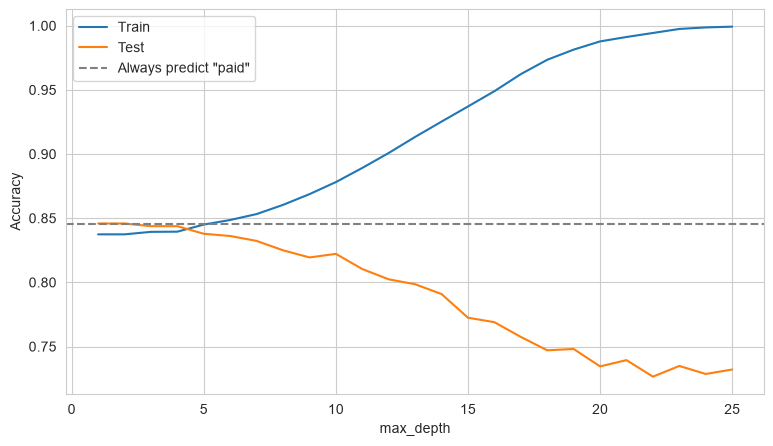
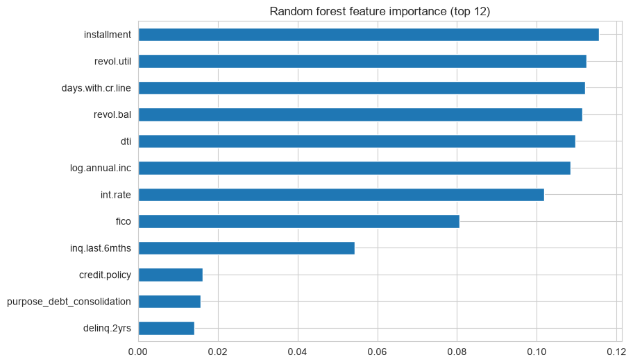

# 04 · Decision Trees & Random Forests: Is Accuracy Enough?

**Questions:** How do decision trees split the data? Does a random forest beat a single tree? Is accuracy a good metric on imbalanced data?

**Data**
- **LendingClub:** 9,578 loans, 13 features; target `not.fully.paid` (16% positive, so the classes are imbalanced)
- **Kyphosis:** 81 children after spinal surgery (small-sample case)

**Approach:** EDA → dummy encoding → decision tree vs. random forest → tree depth vs. overfitting → feature importance → class-weighted models. Kyphosis results are checked with 5-fold cross-validation.

## Results (LendingClub, test set of 2,874 loans)

| Model | Accuracy | Recall: loans not repaid | F1 |
|---|---|---|---|
| Always predict "paid" | 0.846 | 0.00 | – |
| Decision tree | 0.734 | 0.23 | 0.21 |
| Random forest | **0.845** | 0.02 | 0.04 |
| Random forest, `class_weight='balanced_subsample'` | 0.725 | **0.40** | **0.31** |

 

## Takeaways
1. **Accuracy is misleading on imbalanced data.** The random forest "wins" at 84.5% accuracy but catches only 2% of the bad loans, no better than always saying "paid".
2. **Class weighting** raises bad-loan recall to about 40% at the cost of accuracy, which is usually the right trade-off for a lender.
3. **Deep trees overfit:** training accuracy climbs towards 100% while test accuracy drops.
4. **Small samples are unstable:** on Kyphosis (25 test children) the ranking of tree vs. forest flips depending on the random split.

➡️ [Open the notebook](notebook.ipynb)
