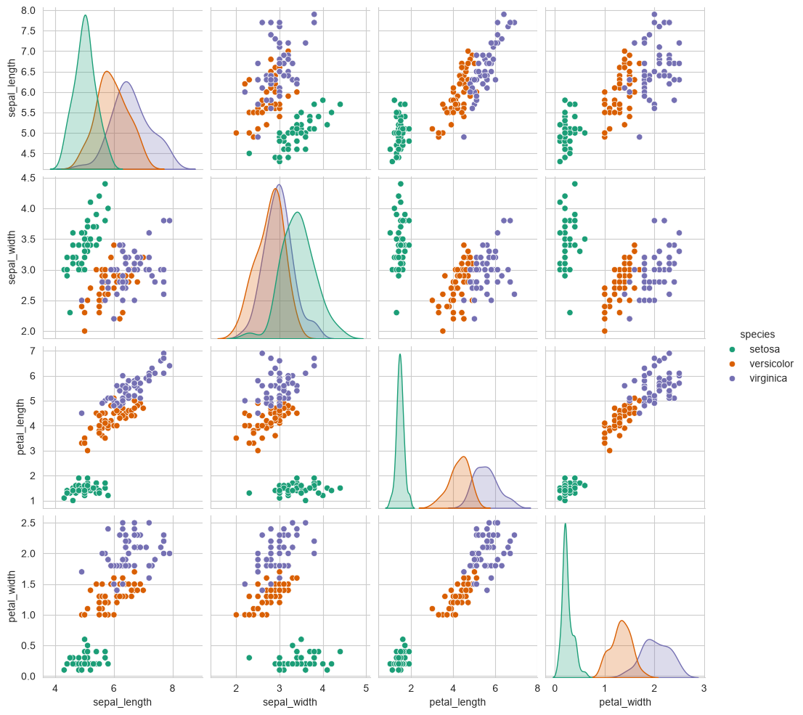

# 05 · Support Vector Machines: Classifying Iris Species

**Question:** How well does an SVM separate the three iris species, and does hyper-parameter tuning help?

**Data:** Iris dataset (Fisher, 1936): 150 flowers, 4 measurements, 3 species.

**Approach:** EDA → SVM (RBF kernel) with default settings → `GridSearchCV` over `C` and `gamma` with 5-fold cross-validation.

## Results

| Model | Test accuracy | CV accuracy |
|---|---|---|
| SVC (default, `gamma='auto'`) | 1.00 | – |
| SVC tuned (`C=1, gamma=0.1`) | 0.98 | 0.96 |

## Takeaways
- *Setosa* is perfectly separable; all errors occur between *versicolor* and *virginica*, where the pairplot shows overlap.
- With a 45-flower test set, one flower is a 2-point difference in accuracy. The cross-validated score is the more reliable estimate, and tuning brings no real gain on such an easy dataset.

➡️ [Open the notebook](notebook.ipynb)
