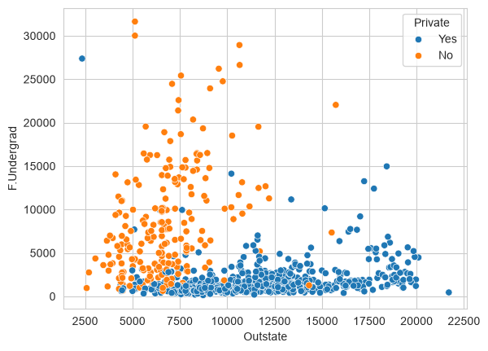

# 06 · K-Means Clustering: Private vs. Public Colleges

**Question:** Without seeing the labels, can K-Means split 777 US colleges into private and public?

**Data:** US College dataset (ISLR): 17 numeric features such as applications, tuition, enrolment, graduation rate.

**Approach:** EDA → data cleaning (a graduation rate of 118% capped at 100%) → K-Means with 2 clusters → compare clusters with the true labels.

## Results

| | Precision | Recall |
|---|---|---|
| Public | 0.69 | 0.35 |
| Private | 0.79 | 0.94 |
| **Agreement with true labels** | | **78%** |

## Takeaways
- K-Means recovers most private colleges, but most public colleges end up in the "private" cluster too.
- The features were **not scaled**, so large-valued variables (applications, enrolment, expenditure) dominate. The algorithm mostly separated **large vs. small** universities rather than public vs. private.
- **Next steps:** standardise features, choose K with the elbow / silhouette method, visualise clusters with PCA.

➡️ [Open the notebook](notebook.ipynb)
